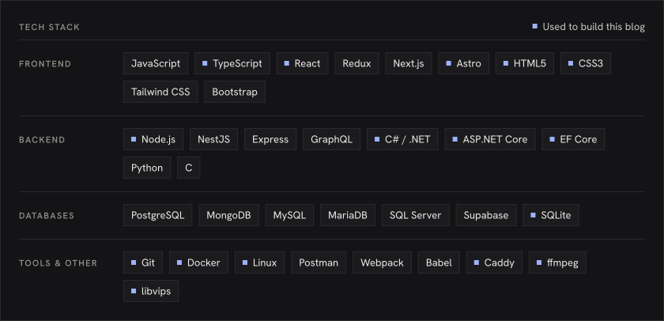
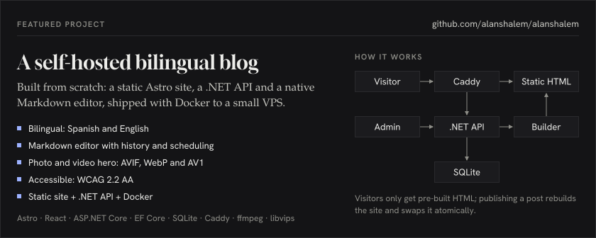
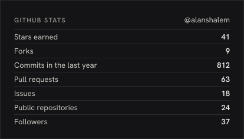
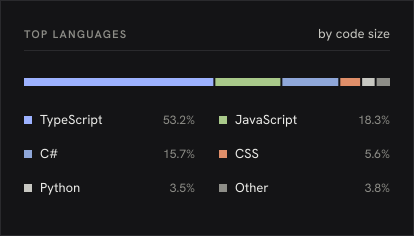
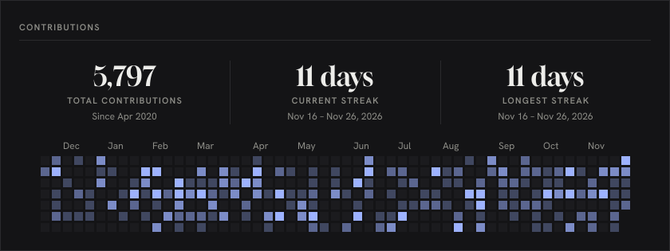
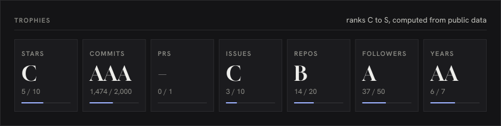

  

### About me

- Full Stack Developer specializing in React, Node.js and TypeScript
- Always learning and exploring new technologies
- Based in Argentina
- Ask me about JavaScript, TypeScript, React, Node.js and SQL

  

  

  
  

  

  

### Latest writing

<!-- BLOG-POSTS:START -->
The blog is on its way — new posts will show up here.
<!-- BLOG-POSTS:END -->

### Say hi

- LinkedIn — [linkedin.com/in/alanshalem](https://www.linkedin.com/in/alanshalem)
- GitHub — [github.com/alanshalem](https://github.com/alanshalem)
- X — [@alanshalem_](https://x.com/alanshalem_)
